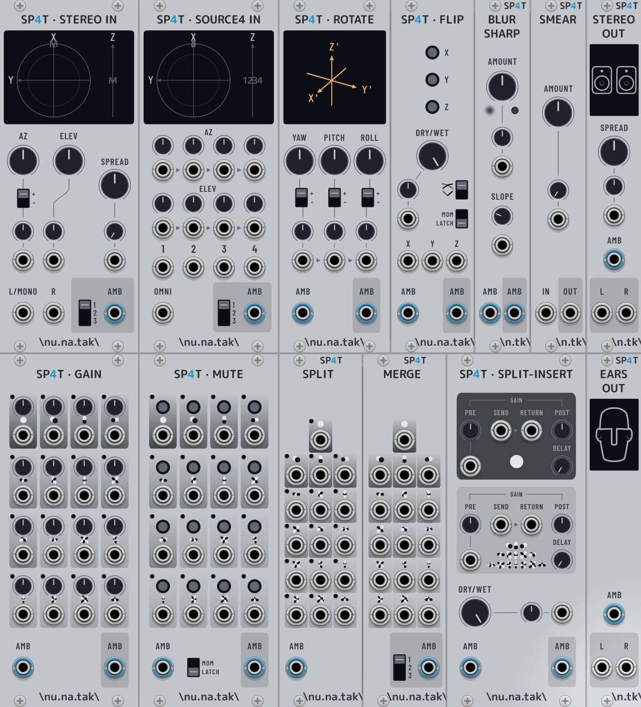
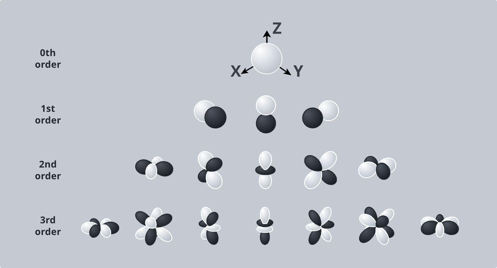

# Nun4tak SP4T

A [VCV Rack](https://vcvrack.com/) plugin providing
[ambisonic](https://en.wikipedia.org/wiki/Ambisonics) 3D spatial audio modules.

Ambisonic input/output signals use the ACN channel ordering and SN3D normalization
conventions (ambiX), unless otherwise specified.



## What is ambisonics?

Ambisonics encodes a full-sphere sound field using spherical harmonics expansion
(figure 1): it is a multi-channel audio encoding technique where each channel
carries a given harmonic function sampled at the audio rate (see below for more
details on how to interpret those signals). This *scene-based* encoding
contrasts with the usual *channel-based* encoding (1 channel = 1 speaker) and
*object-based* techniques such as Dolby Atmos, where each object carries its own
audio stream plus positional metadata.



*Figure 1: Representation of spherical harmonic functions up to order 3.*

Despite being less popular, ambisonics has multiple advantages that offer real
opportunities for sound design and audio synthesis:

- It is a relatively simple and non-proprietary technique.
- It is speaker-agnostic: the same encoded signal can be decoded in many
  different ways, e.g., to binaural or to any speaker layout, whether standard
  or arbitrary.
- The whole sound field can be processed in simple and efficient ways, like
  exact (lossless) field rotation or mirroring. It is an advanced panning tool.
- Applications go well beyond panning: for example, the omni vs. directional
  components of the sound field can be easily decoupled and processed
  independently.

It also has a few limitations:

- It is directional, far-field only.
- The spherical harmonic expansion is truncated at a given order, which sets
  the finite spatial resolution and sharpness of the encoded sound field. Lower
  orders are subject to spatial blur.

To each order *N* corresponds a fixed number *(N+1)²* of ambisonic audio
channels: 1st order = 4, 2nd order = 9, 3rd order = 16 (figure 1).

### Ambisonics vs. 3D spatial audio

The 1st limitation above deserves a bit more explanation. Standard ambisonics
indeed does not natively integrate the concept of distance to a sound source.
Instead, it assumes that the sound is coming from all directions to the center
of the field as plane waves. This makes the maths simpler: a full-sphere sound
field can then be represented simply by real spherical harmonics expansion. A
sphere is 3D geometric object but spherical harmonics functions are defined on
the *surface* of the sphere; it may therefore be more accurate to define
ambisonics as a "2.5D" technique rather than a full 3D spatial audio technique.

A basic encoder converting point sources into an ambisonic signal takes only
the *directions* (azimuth, elevation) to these sources. It is common, however,
that encoders integrate ambisonics with other kinds of pre-processing algorithms
to simulate things like proximity effect, wall reflections, doppler effect for
moving sources, etc.

## Why ambisonics in modular synthesis / VCV Rack?

The point of ambisonics in a modular context goes well beyond immersive-audio
playback. Because each ambisonic channel is just an ordinary audio signal, the
whole sound field becomes something that can be patched, modulated, processed
and routed like anything else on the rack (note: ambisonic channels do not carry
"speaker" signals, and some operations stay spatially meaningful only when they
are applied consistently across the whole channel set).

There is no obligation to represent a realistic scene: the ambisonic channels
can just as well carry different sound *textures* mapped across a sphere,
turning spatial operations into a powerful sound-design tool. And why not try
using it with CV signals? There's no limitation, really.

Modular synthesis has the right workflow for exploring the full range of
ambisonic possibilities. VCV Rack's polyphonic cables also make it very
convenient to carry ambisonic signals between modules (up to 3rd order = 16
channels, hopefully more in the future?).

This VCV Rack plugin aims to provide a comprehensive set of modules for
typical ambisonic operations such as **encoding** one or more sources into a 3D
sound field — or directly **synthesizing** the sound field — **rotating,
flipping, decoupling and processing** that field, and finally **decoding** it
to a mono, stereo or binaural signal or to any array of speakers. In the spirit
of modular synthesis, almost anything can be controlled and CV modulated!

## How to interpret the ambisonic channels?

A First-Order Ambisonic (FOA) signal has 4 channels W,X,Y,Z (the so-called
*B-format*). The table below follows the ACN channel-ordering convention.

| Channel (ACN) | Order | Axis | Direction | Plot |
|---|---|---|---|---|
| 0 | 0th | (W) | isotropic / omnidirectional |  |
| 1 | 1st | Y   | left–right |  |
| 2 | 1st | Z   | top–bottom |  |
| 3 | 1st | X   | front–rear |  |

In idealized settings, the first channel corresponds to the sound that would be
picked up by an omnidirectional microphone, while the other three channels
relate to what would be picked up by figure-8 microphones oriented along the
X,Y,Z axes.

The first two ACN channels W,Y are thus equivalent — up to some gain
normalization — to the familiar "mid-side" representation of a stereo signal.
Ambisonics may indeed be viewed as a generalization of the "mid-side" concept to
3D spatial audio!

Subsequent channels, if any, represent Higher-Order Ambisonics (HOA). They are
harder to interpret, since they correspond to more complex harmonics, most of
which contain information across more than one axis (figure 1).

## Plugin Modules

### Encoders

- **SP4T Stereo In** — Ambisonic encoder for one panned mono or stereo source.
- **SP4T Source4 In** — Ambisonic encoder for up to four point sources.

### Decoders

- **SP4T Stereo Out** — Decodes the sound field to a pair of stereo speakers.
- **SP4T Ears Out** — Decodes the sound field to headphones (binaural).

### Processors

- **SP4T Rotate** — Rotates the whole sound field.
- **SP4T Flip** — Mirrors the sound field across one or more axes.
- **SP4T Blur Sharp** — Blurs or sharpens the sound field.

### Utilities

- **SP4T Gain** — A gain per ambisonic channel.
- **SP4T Mute** — A mute per ambisonic channel.
- **SP4T Split Insert** — Two effect inserts, one for the omni part of the field and one for the rest.
- **SP4T Split** — Splits an ambisonic signal into its separate channels.
- **SP4T Merge** — Builds an ambisonic signal from separate channels.
- **SP4T Smear** — Decorrelates the channels of a polyphonic signal.

## Requirements

- [VCV Rack SDK](https://vcvrack.com/Rack#sdk) 2.6.6, unpacked as
  `SDKs/Rack-SDK` (not vendored in this repo)
- CMake 3.19 or newer and a C/C++ toolchain
- Optional: [pixi](https://pixi.sh), which provides CMake and the task shortcuts
  below

Download the SDK for your platform, replacing `mac-arm64` with `mac-x64`,
`lin-x64` or `win-x64` as needed:

```sh
curl -L -o Rack-SDK.zip https://vcvrack.com/downloads/Rack-SDK-2.6.6-mac-arm64.zip
unzip -d SDKs Rack-SDK.zip
```

## Configure, build, install

```sh
pixi run configure   # cmake -S . -B build -DCMAKE_BUILD_TYPE=Release
pixi run build       # cmake --build build --parallel 4
pixi run install     # cmake --install build
pixi run dist        # cmake --build build --target plugin_dist
pixi run clean       # cmake -E rm -rf build
```

Configuring also writes a `build/compile_commands.json` compilation database
(`-DCMAKE_EXPORT_COMPILE_COMMANDS=ON`). `pixi run compile-commands` configures
and symlinks it into the repository root, where language servers look for it:

```sh
pixi run compile-commands   # -> compile_commands.json (git-ignored symlink)
```

`build` and `dist` configure first, and `install` builds first, so
`pixi run install` is enough from a clean checkout. Without pixi, run the CMake
commands shown in the comments directly.

## Module panels

Panel SVGs are edited in `res/staging/`, where text is kept as editable text
objects. Rack does not render SVG text, so convert it to paths before building:

```sh
# one panel at a time, named after its SVG file without the extension;
# both the light and the dark version are exported (requires Inkscape)
pixi run export-panel SP4TGain   # res/staging/SP4TGain[-dark].svg -> res/
```

The exported files in `res/` are generated: edit the staging files instead. The
task runs `res/staging/export-panel.sh`, which also drops the panel's
`components` layer (a positioning aid: Rack draws those widgets from
`res/components/`).
Fonts used by the panels but not installed by default (e.g., M PLUS Rounded 1c, SIL OFL)
are shipped in `res/staging/fonts/`, which the script makes available to
Inkscape via `res/staging/fonts/fonts.conf`.

## Build output

`build` produces a ready-to-load plugin directory at `build/Nun4tak/`. `install`
copies it into the Rack user plugin folder, which defaults to
`~/Library/Application Support/Rack2/plugins-mac-arm64` on macOS,
`$XDG_DATA_HOME/Rack2/plugins-lin-x64` on Linux and
`%LOCALAPPDATA%/Rack2/plugins-win-x64` on Windows. Restart Rack afterwards.
`dist` writes a distributable `.vcvplugin` archive to `build/dist/`.

If the SDK lives elsewhere, pass `-DRACK_SDK_DIR=<path>` when configuring. To
install to a different folder, pass `-DCMAKE_INSTALL_PREFIX=<path>`. For a debug
build, configure with `-DCMAKE_BUILD_TYPE=Debug`.

## Code formatting and linting

A [prek](https://prek.j178.dev) commit hooks (e.g., code formatting) are
configured in `.pre-commit-config.yaml`). Install it once per clone, and run the
hooks by hand over the whole repository with `prek`:

```sh
pixi run install-prek-hooks   # prek install -> .git/hooks/pre-commit
pixi run prek                 # prek run --all-files
```

## Build documentation

The manual — an ambisonics primer and a page on each module — is written in
Markdown under `doc/` and built with Sphinx:

```sh
pixi run doc   # -> doc/_build/html
```

## Disclaimer

The development of this plugin has been AI assisted. It has *not* been "vibe"
coded.

The module panels have been carefully designed and edited by hand. AI has been
used only for minor ajustements, fixes and more complex drawings such as the
spherical harmonic functions.

The code of this plugin has been written using AI, with careful human
interaction, review and testing. Most of the ambisonic DSP relies on the
[Spatial Audio
Framework](https://github.com/leomccormack/Spatial_Audio_Framework) (dual ISC /
GNU GPLv2 licence) that is also used by the
[SPARTA](https://github.com/leomccormack/SPARTA) audio plugins. Many thanks to
the developers of those tools for making them available publicly!

The documentation has been written and edited mostly by me.

I'm an experienced software developer who is pretty familiar with concepts and
tricks used in real-time audio-DSP programming, but I don't have yet a strong
expertise in this domain! This project is also a good way of getting myself into
ambisonics and the development of VCV rack plugins, an exciting and fun
experience! There may be bugs or mistakes as I'm still learning those things. If
you find any, please do not hesitate to report it!
